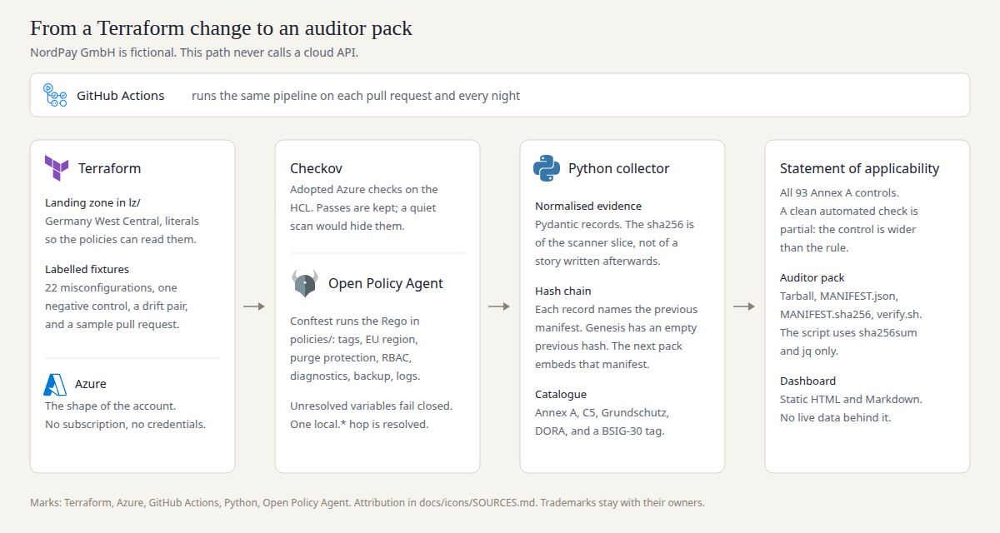

# iso27001-evidence-as-code

Offline evidence pipeline for a fictional Berlin payment institution, NordPay GmbH. A Terraform landing zone is scanned with Checkov and with Conftest (OPA Rego). The collector writes one evidence record per result, hashes the scanner slice, and chains that hash to the previous manifest. A small catalogue maps those rules onto control ids. The rollup is a statement of applicability for all 93 Annex A controls, and the export is a tarball an auditor can re-hash with `sha256sum` and `jq`.

NordPay is not a real company. A passing check is a passing check. It is not a certification, and the short titles in this repo are glosses written for the demo.



Marks in the diagram are the vendors'. Attribution is in [docs/icons/SOURCES.md](docs/icons/SOURCES.md).

## The numbers

Produced by `eac demo` on this repository, host `cursor`, Linux 6.12.94, Python 3.12.3, Checkov 3.2.449, Conftest 0.71.1 (OPA 1.21.1), Terraform v1.10.5. The run started at `2026-10-27T12:19:08Z` and finished at `2026-10-27T12:19:12Z`. The raw record is [`results/summary.json`](results/summary.json). Re-running the command writes a new file, because each record carries `observed_at`.

| What | Measured |
| --- | --- |
| Annex A controls with an automated check | 15 of 93 (16.1%) |
| SoA on `lz/`: partial / manual / not applicable | 15 / 76 / 2 |
| Automated-pass and automated-fail on the clean landing zone | 0 and 0 |
| Landing-zone check failures | 0 |
| Own fixtures (22 misconfigured, 1 negative control) | TP 26, FP 0, FN 0, TN 270 |
| TerraGoat technical (held out, Apache-2.0, not vendored) | TP 17, FP 0, FN 1, TN 3 |
| TerraGoat against the NordPay Rego only | TP 3, FP 0, FN 0, TN 5 |
| C5:2020 criteria with a mapped check | 15 of 121 (12.4%) |
| DORA articles in the tracked slice with a mapped check | 4 of 8 (50.0%) |
| Pack build, median of 10, evidence already collected | 0.004488 s |
| Scan, then the whole pipeline | 2.4114 s, then 3.9689 s |
| Drift | A.8.9 and A.8.24 lost evidence at `35d84e21208c6d0758dc0cb8cb77d41d5b402cf2` |

The 0.004488 s figure is only the export loop. The scan is the 2.4114 s. Both clocks are in `results/summary.json` under `export` and `scan_seconds`. The ten pack builds share one frozen timestamp so they hash the same bytes; the stopwatch itself stays outside the manifest.

Own-fixture true/false counts are a self-check. The fixtures and the policies were written together, which is why a score of FP 0 and FN 0 mostly means the pipeline still matches its labels. TerraGoat is the less circular number. Its one false negative is `CKV_AZURE_3`: Checkov treats a missing `enable_https_traffic_only` as a pass, and the TerraGoat storage account never sets the attribute. That expectation was written from the HCL before the scan.

## Run it

You need Python 3.12, Terraform 1.10.5, Conftest 0.71.1, Checkov 3.2.449, `jq`, and `sha256sum`. The versions are pinned in [`requirements-tools.txt`](requirements-tools.txt). CI installs those same pins.

```bash
python3 -m pip install -e ".[dev]"
make demo
```

`make demo` scans the repo, scores the fixtures, fetches TerraGoat at commit `729f8da62c6a85ce4af5ad3d123de97776d954c4`, writes `results/` and `dashboard/`, verifies the pack, flips one byte, and shows `verify.sh` reject it. The walkthrough, timed for a quarter of an hour, is [docs/DEMO.md](docs/DEMO.md).

Open `dashboard/index.html` in a browser. The same rollup is `dashboard/soa.md`.

## What sits where

- `lz/` is the landing zone. Region and tags are locals, because the Rego resolves one `local.*` hop and leaves `${var...}` unevaluated, which fails closed. `terraform validate` is as far as v1 goes.
- `policies/` is the NordPay Rego: classification and owner tags, an EU region list, purge protection on confidential vaults, no Owner on a subscription scope, diagnostics and a recovery vault for production, log retention.
- `catalog/rules.yaml` is the judgment of which rule supports which id. `catalog/annex_a.yaml` is all 93 Annex A controls, with applicability decided as an ISMS choice for this fiction.
- `fixtures/known-bad/` is the labelled set. `fixtures/drift/` is a good storage account and the same account on TLS 1.0. `fixtures/pr-preview/` is the stand-in for a bad pull request (public blobs and TLS 1.0), which fails A.5.15, A.8.3, A.8.9 and A.8.24.
- `eac` is the collector, the rollup, the pack, and the dashboard.

A clean automated check is **partial**. Every Annex A control we touch still has an organisational remainder, so the rollup keeps `automated-pass` at 0 on purpose. The two not-applicable controls are A.7.6 (no secure room; the Berlin office is an ordinary workplace) and A.8.30 (no outsourced development). Both decisions are written next to the control and would be revisited if the fiction changed.

The 15 controls with a check are A.5.9, A.5.12, A.5.15, A.5.23, A.5.28, A.8.2, A.8.3, A.8.5, A.8.9, A.8.13, A.8.14, A.8.15, A.8.16, A.8.20 and A.8.24. C5 ids in the same catalogue: AM-01, AM-06, COS-01, COS-02, COS-05, COS-08, CRY-02, CRY-04, IDM-06, IDM-07, IDM-09, OPS-06, OPS-10, OPS-14, PSS-12. The 121 in the denominator is the size of the C5:2020 catalogue as stated on the BSI introduction page linked from `catalog/rules.yaml`. IT-Grundschutz shows up as module ids only (APP.3.1, CON.1, CON.3, DER.1, NET.1.1, NET.3.2, OPS.1.1.2, OPS.1.1.5, OPS.2.2, ORP.4), with no percentage of the compendium. The DORA slice tracked here is Art. 5, 6, 8, 9, 10, 11, 12 and 13; the rules actually hit Art. 8, 9, 10 and 12. `BSIG-30` is a crosswalk tag. NordPay is framed as a payment institution, so the demo treats DORA as the regime in scope. I have not had a lawyer confirm the wording of the NIS2 lex-specialis displacement.

## GitHub Actions

[`.github/workflows/evidence.yml`](.github/workflows/evidence.yml) runs on pull requests, on a nightly schedule (`17 3 * * *`), and on demand. It validates the landing zone and runs pytest.

Two steps stay off unless a repository variable says otherwise. `EAC_CAPA=true` opens and closes GitHub issues labelled `corrective-action`, using `GITHUB_TOKEN`. Locally the same command skips unless `EAC_CAPA=1`, `GITHUB_TOKEN` and `GITHUB_REPOSITORY` are all set. `EAC_COSIGN=true` installs Cosign and keyless-signs the manifest digest. The sha256 chain does not depend on either flag.

## Limitations

- v1 reads Terraform. Live Azure, a service principal, and Prowler are an optional mode that is not built and not required.
- AWS is future work.
- The provider pin is azurerm `~> 3.117.0` because the adopted Checkov rules read `enable_https_traffic_only` and `azurerm_monitor_log_profile`. Both are deprecated on the way to azurerm 4. `terraform validate` warns about that and still accepts the configuration.
- Checkov 3.2.449 matches internet sources by exact string. `*` is in that list. The CIDR `0.0.0.0/0` is not, so the SSH and RDP fixtures use `*`. A rule written with the CIDR would slip past those two checks.
- `CKV_AZURE_3` passes when the HTTPS-only attribute is absent. TerraGoat hits that, and the held-out score records the miss.
- Cosign is optional. The chain a reviewer can check without Sigstore is `MANIFEST.sha256` plus the embedded previous manifest.
- There is no PDF report.
- TerraGoat (Bridgecrew, Apache-2.0) is fetched at test time. It is not copied into the repo. See `fixtures/held-out/`.

## Kurzfassung / Überblick auf Deutsch

NordPay GmbH ist ein erfundenes Zahlungsinstitut in Berlin. Dieses Repository zeigt **Nachweisautomatisierung** für eine kleine Azure-Landing-Zone, ohne Cloud-Konto und ohne Anmeldedaten.

Der Weg ist **Compliance-as-Code**. Die Zone steht in Terraform (`lz/`). **Policy-as-Code** sind die Rego-Regeln unter `policies/`, ausgeführt mit Conftest, plus ein festgelegter Satz Checkov-Prüfungen auf dem HCL. Der Python-Kollektor schreibt pro Ergebnis einen Nachweis, bildet den sha256 über die Scanner-Ausgabe und hängt den Hash des vorherigen Manifests an. Daraus wird ein Paket mit **Prüfungsnachweisen**: Tarball, `MANIFEST.json`, `MANIFEST.sha256` und `verify.sh`. Das Skript braucht nur `sha256sum` und `jq`.

**Compliant-by-Design** heißt hier etwas Enges. Die Landing Zone ist so geschrieben, dass die übernommenen Prüfungen auf `lz/` durchlaufen (0 Fehler in diesem Lauf). Ein bestandener Check setzt den Annex-A-Control trotzdem auf `partial`, weil der Control organisatorisch weiter reicht als die Regel. `automated-pass` bleibt in diesem Stand 0. Von 93 Annex-A-Controls haben 15 eine automatisierte Prüfung, also 16.1%. Im SoA für `lz/` stehen 15 partial, 76 manual und 2 not applicable (A.7.6, kein Sicherheitsraum; A.8.30, keine ausgelagerte Entwicklung). Die Titel sind eigene Kurzfassungen. Texte aus ISO/IEC 27001, BSI C5 oder DORA stehen hier nicht.

Die eigenen Fixtures (22 Fehlkonfigurationen, eine Negativkontrolle) ergeben TP 26, FP 0, FN 0, TN 270. Das ist ein Selbsttest. TerraGoat, Apache-2.0, Commit `729f8da62c6a`, wird zur Testzeit geholt und nicht eingecheckt: technisch TP 17, FP 0, FN 1, TN 3. Der eine Fehlschlag der Erkennung ist `CKV_AZURE_3`. Die NordPay-Rego auf demselben Baum: TP 3, FP 0, FN 0, TN 5.

Simulierter Drift, offline: `fixtures/drift/broken` senkt TLS auf 1.0. A.8.9 und A.8.24 verlieren den Nachweis bei Commit `35d84e21208c6d0758dc0cb8cb77d41d5b402cf2` (`CKV_AZURE_44`). Das Auditor-Paket aus bereits gesammelten Nachweisen braucht im Median 0.004488 Sekunden über 10 Läufe. Der Scan davor dauerte 2.4114 Sekunden, die ganze Pipeline 3.9689 Sekunden. Quelle ist `results/summary.json`, erzeugt mit `eac demo` am 2026-10-27T12:19:08Z.

C5:2020: 15 von 121 Kriterien haben eine zugeordnete Prüfung (12.4%). DORA wird nur als Ausschnitt geführt (Art. 5, 6, 8, 9, 10, 11, 12, 13); davon sind Art. 8, 9, 10 und 12 getroffen (50.0%). IT-Grundschutz erscheint als Modul-IDs, ohne Anteil am Kompendium. `BSIG-30` ist eine Zuordnung, keine zweite Pflicht und kein Deckungsgrad. Ob die Verdrängung nach NIS2 für dieses Zahlungsinstitut so trägt, hat kein Anwalt geprüft.

Start: `make demo`. Die Führung in unter 15 Minuten steht in `docs/DEMO.md`. Live-Azure, Prowler und AWS sind nicht Teil von v1. Corrective-Action-Issues und Cosign-Signatur laufen nur, wenn das ausdrücklich eingeschaltet wird. Die sha256-Kette gilt auch ohne sie.

## Licence

MIT. See [LICENSE](LICENSE).
